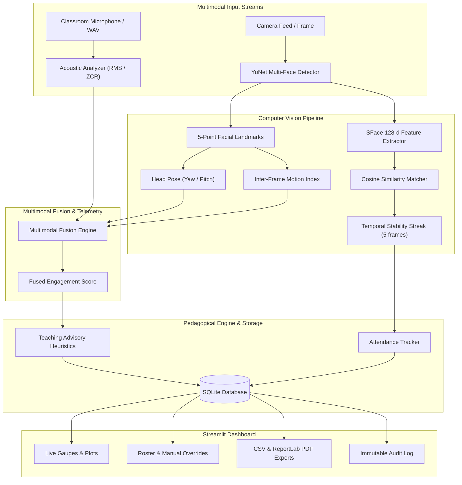

# Multimodal Classroom Attendance & Engagement Agent

[](https://www.python.org/)
[](https://streamlit.io/)
[](https://opencv.org/)
[]()
[]()

A privacy-preserving, multimodal educational telemetry agent designed for smart classrooms. It integrates computer vision (face recognition & head-pose orientation tracking), acoustic activity analysis (RMS energy & silence intervals), and pedagogical advisory heuristics into an interactive Streamlit dashboard.

---

## 🌟 Key Capabilities

### 1. Privacy-First Biometric Verification
- **Zero Raw Image Storage**: Facial images captured during enrollment or live monitoring are processed in RAM memory and immediately discarded.
- **128-Dimensional Cosine Embeddings**: Extracted using the official OpenCV Zoo **SFace** ONNX deep metric model, producing irreversible mathematical vectors.
- **Consent-First Architecture**: Explicit informed consent is mandatory for biometric registration.
- **Inclusive Opt-Out Guarantee**: Students who decline biometrics can register for non-biometric manual ID roll-call with zero academic penalty.
- **Right to be Forgotten**: One-click student deactivation instantly purges all stored biometric templates.

### 2. Multi-Face Temporal Stability Buffer
- Employs **YuNet** for fast multi-face detection and 5-point landmark estimation.
- Enforces a temporal stability buffer: students must be detected across consecutive frames (`SUSTAINED_DETECTION_FRAMES = 5`) before attendance is formally marked `PRESENT`, eliminating transient false positives.

### 3. Observable Visual Engagement Telemetry
- **Head Pose Estimation**: Analyzes landmark symmetry ratios to approximate yaw and pitch deviations from the display/board.
- **Motion Dynamics**: Uses normalized Gaussian inter-frame differencing to measure physical restlessness vs. frozen camera states.
- **Face Visibility Rate**: Continuously tracks the proportion of enrolled students visibly present.

### 4. Acoustic Sensing & Pacing Analysis
- Analyzes ambient classroom audio using Root Mean Square (RMS) energy and Zero Crossing Rate (ZCR).
- **Prolonged Silence Detector**: Flags acoustic lulls exceeding 15 seconds to identify student hesitation or cognitive pause.

### 5. Multimodal Fusion Engine
- Computes a weighted engagement score fusing:
  $$\text{Fused Score} = (0.40 \times \text{Visibility}) + (0.35 \times \text{Head Alignment}) + (0.25 \times \text{Audio Interaction})$$
- Dynamically rescales to pure visual mode if ambient audio is toggled off.

### 6. AI-Assisted Pedagogical Advisory
- Rule-based heuristics engine providing constructive, non-evaluative recommendations:
  - *Prolonged silence* &rarr; Suggests open-ended concept check questions.
  - *Attentional shift (>50% deviation)* &rarr; Recommends interactive polls or live code demonstrations.
  - *High restlessness* &rarr; Proposes short peer-discussion breakouts.
  - *High sustained focus* &rarr; Encourages the instructor to maintain pacing.
- Implements cooldown buffers to prevent notification fatigue.

### 7. Auditing & Reporting
- **Manual Instructor Override**: Teachers retain final authority to modify attendance with mandatory justification logging.
- **Export Formats**: One-click CSV roster download and institutional-grade PDF audit reports built with **ReportLab**.
- **Immutable Audit Trail**: All system actions (`SESSION_START`, `STUDENT_ENROLLED`, `ATTENDANCE_OVERRIDE`) are logged to SQLite.

---

## 🏛️ System Architecture



---

## 📁 Repository Structure

```
├── .gitignore                          # Standard Python/runtime ignore rules
├── .streamlit/
│   └── config.toml                     # Streamlit server & UI configuration
├── app.py                              # Central 8-Tab Streamlit Dashboard
├── config.py                           # System thresholds, weights, and paths
├── requirements.txt                    # Python dependencies
├── README.md                           # Project documentation
│
├── models/
│   ├── README.md                       # Model documentation & download links
│   ├── face_detection_yunet_2023mar.onnx    # YuNet face detector
│   └── face_recognition_sface_2021dec.onnx  # SFace face embedding model
│
├── modules/
│   ├── audio_analysis.py               # Acoustic DSP, RMS, ZCR, and silence detector
│   ├── database.py                     # SQLite schema (6 tables), transactions, audit trail
│   ├── download_models.py              # Automated downloader for OpenCV Zoo weights
│   ├── engagement_analysis.py          # Landmark head-pose, motion index, and fusion
│   ├── face_recognition_attendance.py  # YuNet + SFace recognition & sustained tracker
│   ├── reporting.py                    # CSV export & ReportLab PDF report generator
│   ├── student_registration.py         # Biometric consent & non-biometric registration
│   └── teaching_suggestions.py         # Pedagogical heuristics engine
│
├── reports/                            # Output directory for CSV and PDF reports
│
└── tests/
    ├── test_database.py                # Database CRUD and session lifecycle tests
    ├── test_engagement_and_audio.py    # Head pose, motion index, RMS, and fusion tests
    ├── test_face_recognition.py        # Cosine similarity and streak tests
    ├── test_reporting.py               # Summary tables, CSV, and PDF build tests
    └── test_teaching_suggestions.py    # Pedagogical rules and cooldown tests
```

---

## 🚀 Quickstart Guide

### 1. Prerequisites
- Python 3.10 – 3.14
- Standard webcam or microphone (optional: built-in simulated test modes available)

### 2. Installation
```powershell
# Clone the repository
git clone https://github.com/9oiujkl/Multimodal-Attendance-Engagement-Agent.git
cd Multimodal-Attendance-Engagement-Agent

# Create and activate virtual environment
python -m venv venv
.\venv\Scripts\Activate.ps1

# Install dependencies
pip install -r requirements.txt

# Download pre-trained OpenCV Zoo ONNX weights
python modules/download_models.py
```

### 3. Run Automated Tests
```powershell
pytest -v tests/
```
*(All 19 automated tests should pass with 100% green status)*

### 4. Launch the Web Application
```powershell
streamlit run app.py
```
Open your browser at `http://localhost:8501`.

---

## 🔒 Ethical & Privacy Declaration

> **Important Disclosure:** Observable behavioral indicators (head orientation, motion frequency, and ambient sound activity) are recorded for aggregate classroom feedback only. They do **NOT** measure psychological engagement, comprehension, intelligence, or student aptitude. Raw facial imagery is never retained.

---

## 📄 License
This project is open-source and available under the [MIT License](LICENSE).
